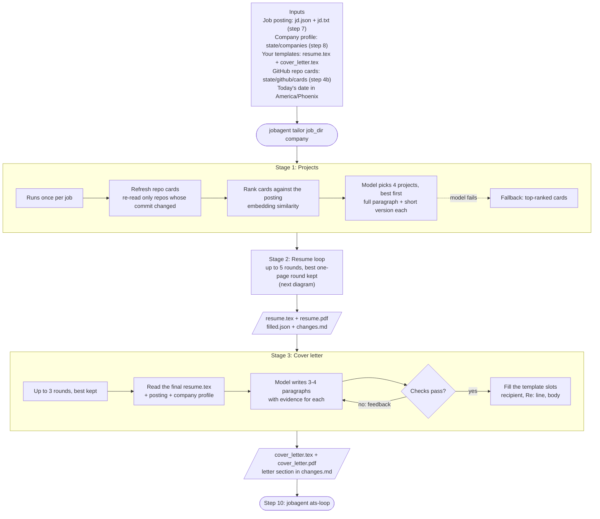
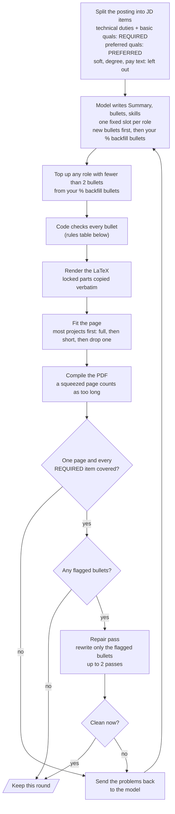

# Step 9 — Resume and cover letter tailoring

For each scraped job, the agent writes a one-page resume and a matching one-page cover letter from your LaTeX
templates. The resume's bullets come from the posting's duties and technical qualifications, its Projects from your
GitHub repos, and its skills from the posting's tech stack. Code checks every rule you set (one unsqueezed page,
no invented employers, no dashes, "by N%", …) and sends problems back to the model until the result is clean.

**Status:** gate passed 2026-10-27 (`jobagent step tailor-check` on the 5 step-7 postings: Stripe, Palantir,
OpenAI, NVIDIA, Amazon; live scrape → research → resume + cover letter). Every resume and letter is one page,
locked parts unchanged, every required posting item covered by a new bullet, 0 flagged bullets, 2-4 bullets per
role, 2-3 projects, letters consistent with their resumes, no dashes as punctuation. Failures along the way were
fixed in code; no output was edited by hand.

## Run it

```bash
jobagent scrape <url>                                     # step 7 → outputs/<company>/<job-id>/
jobagent research "<Company>"                             # step 8 → state/companies/<slug>.md
jobagent tailor outputs/<company>/<job-id> <slug>         # resume + cover letter (.tex/.pdf), changes.md
jobagent cover-letter outputs/<company>/<job-id> <slug>   # rewrite the letter after you edit resume.tex
jobagent step tailor-check                                # the gate: 5 postings end to end
python -m jobagent.tools.repo_cards [workers] [--force]    # (re)build the GitHub repo cards on their own
```

## How it works

The pipeline has three stages. Projects are chosen once, the resume is written in rounds until it passes every
check, and the cover letter is written last from the finished resume so the two always agree.



### Inside one resume round



Notes on the diagrams:

- **The model** is Voyager's `glm-5-3`, always with an enforced JSON schema. Every prompt ends with today's date in
  America/Phoenix (`jobagent.clock`), so "present", "latest" and "recent" mean the same thing everywhere.
- **A failed model call** (timeout, token limit, connection error) costs one round, not the whole job.
- **"Squeezed"**: TeX shrinks spacing to fit a nearly full page without warning; `compile_pdf` turns that warning on
  (`\vbadness=0`) and treats a squeezed page like a second page, so sections never get crushed.
- **Best round kept**: fewest flagged bullets, then most projects; the loop stops at the first clean round.

## Inputs and outputs

| | What | Where |
|---|---|---|
| In | The posting, as extracted and as written | `outputs/<company>/<job-id>/jd.json`, `jd.txt` |
| In | Cited company profile | `state/companies/<slug>.md` |
| In | Your resume template (locked parts, `% backfill` bullets, `\resumeProjectText`) | `data/templates/resume.tex` |
| In | Your cover letter template (`<<RECIPIENT>>`, `<<SUBJECT>>`, `<<SALUTATION>>`, `<<BODY>>`, `<<CLOSING>>`) | `data/templates/cover_letter.tex` |
| In | One card per GitHub repo (own + contributed) | `state/github/cards/` |
| Out | The tailored resume | `resume.tex`, `resume.pdf` |
| Out | The model's raw output (Summary, bullets, skills) | `filled.json` |
| Out | Review report: estimated numbers to confirm, where each JD item went, projects, skills, letter evidence | `changes.md` |
| Out | The cover letter | `cover_letter.tex`, `cover_letter.pdf` |

## What is kept and what is written

| Resume part | What happens |
|---|---|
| Preamble, header, section names, role subheadings, Education | Copied byte-for-byte from your template |
| Summary | Written fresh per job and company: the posting's title wording, the requirements you meet, one clause about the company; only facts (degree, years) come from the template |
| Experience | New bullets from the posting's technical duties and qualifications first; your `% backfill` bullets added where a role has room; 2-4 bullets per role |
| Projects | 2-4 GitHub projects: heading (linked name, stack, month and year) + one unbulleted paragraph (problem, solution, system); your template's titles kept when a repo is already there |
| Technical Skills | Rebuilt from the posting's tech stack and qualifications; abstract terms carry concrete tools ("Machine Vision (OpenCV, YOLOv8)"), your own tools preferred |

## Rules enforced in code

Each rule is checked after the model writes; a broken rule goes back to the model (or into the repair pass).

| Rule | Checked by |
|---|---|
| Every REQUIRED JD item is covered by a NEW bullet (your reused bullets don't count) | `tailor.fill_checks` |
| No two bullets repeat each other (shared 4-word phrase or more than 50% same words) | `tailor.duplicates` |
| Professional wording: no faculty, lab, student, thesis, volunteer, unpaid, … | `tailor.quality` |
| Every bullet names a technology; at most one bullet in the resume lacks a result | `tailor.quality` |
| A bullet from one employer never appears under another | `tailor.moved_from` |
| No dash as punctuation (em dash, spaced en dash, `--`); ranges like 2025–2026 are fine | checks + `to_latex` turns leftovers into commas |
| A change by a percentage takes "by" ("cutting failed runs by 45%") | prompts + `to_latex` inserts it |
| Locked parts unchanged; LaTeX compiles; one page without squeezing | `apply_fill`, `compile_pdf` |
| Every estimated number is listed for you to confirm | `fill_checks` → `changes.md` |

## Projects and repo cards

- **Cards** (`state/github/cards/<owner>__<repo>.json` + `.README.md`): one per repo of the resume's GitHub account,
  own and contributed, written by reading the code. The source archive is streamed from codeload.github.com to a
  nameless temp file (deleted after reading, 80 MB cap); the agent reads the file tree, dependency manifests, the
  original README and the main source files and notebooks, and writes a summary, a README for itself, the tech
  stack, technical fields, stated results, kind, substance 1-5 and an embedding.
- **Refresh**: each card stores the default branch's commit SHA. A repo is re-read only when that SHA changes; the
  SHA is checked (git smart-HTTP refs, no API cost) only when the repo's `pushed_at` moved. First build: 104 repos in
  about 16 minutes; a no-change refresh takes about 25 seconds.
- **Choice**: cards with substance 1, configs and personal-site repos are skipped; the rest are ranked by embedding
  similarity to the posting; the model ranks 4 and writes each as a full paragraph and a short version. Shared repos
  are described as whole projects.

## Cover letter

- **Template**: your header (the resume's, verbatim), a rule, then recipient (Hiring Team, company, the posting's
  first location), `Re:` line, salutation, justified body, and the closing with your name on the next line. No date.
- **Re: line**: the job title, plus "Req. …" only for a real requisition number. An id that is part of the posting
  URL (Greenhouse 8130881, Ashby/Lever UUIDs) is the job board's own id and is left out unless it looks like a
  requisition code (letters and digits, e.g. JR2026744).
- **Consistency checks**: every number, tool and proper noun must appear in the resume, the posting or the company
  profile; names are written exactly as on the resume (no abbreviations); no dashes; about 420 words at most; the
  header equals the resume's; one page.

## Learned while building

- Rewording the template's bullets mostly deleted them to fit one page and never reached the posting's duties;
  writing new bullets from the posting fixed that, and only new bullets count as covering it.
- Bullet indices drift between roles: one fixed schema slot per role (`role_0`, …) keeps bullets under the right
  employer, and `moved_from` catches the rest.
- Regenerating the whole resume to fix two bullets traded one problem for another; the repair pass rewrites only the
  flagged bullets and converges in one or two calls.
- `json_schema` length limits truncate instead of failing: free-text limits are set well above what the prompt asks.
- TeX squeezes spacing on a nearly full page without reporting it; `\vbadness=0` makes it visible.
- In LaTeX source `\%` is an escaped percent, not a comment.
- Icon fonts extract as junk characters for an ATS; the templates give the icons empty "actual text" (`accsupp`).
- Voyager is slow with 3 jobs in parallel (rounds of 4-20 minutes, occasional time-outs and connection blips).
