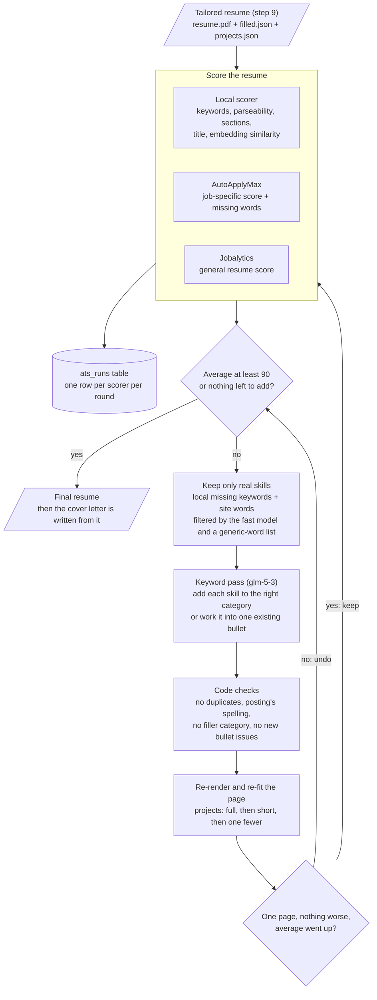

# Step 10 — ATS score loop

After the resume is tailored (step 9), the agent scores it the way applicant tracking systems read it, works the
posting's missing skills in where they truthfully fit, and rescores, up to 5 rounds, aiming for an average of 90.
Every score is recorded, and the cover letter is written afterwards from the final resume.

**Status:** built 2026-10-28; gate run in progress (see the plan's step 10 row for the result).

## Run it

```bash
jobagent tailor outputs/<company>/<job-id> <slug>               # step 9 + this loop + cover letter (default)
jobagent tailor outputs/<company>/<job-id> <slug> --ats-local-only   # loop with the local scorer only
jobagent ats-loop outputs/<company>/<job-id> <slug> [--target 90]   # the loop on an already-tailored resume
jobagent ats outputs/<company>/<job-id>                        # one local score, recorded
```

## How it works



The loop runs at most 5 rounds. A model error or a rejected change costs one round; after a model error the
next round tries with fewer keywords.

## The scorers

| Scorer | What it measures | Notes |
|---|---|---|
| Local (`tools/ats_local.py`) | The posting's tech stack and required/preferred items (required weigh double), parseability of the PDF text (email, phone, header, one page), section headers, title words, embedding similarity | Free and instant; reads the resume like an ATS, from `pdftotext` |
| AutoApplyMax (`tools/ats_sites.py`) | Job-specific score: keywords 40%, formatting, completeness, readability; matched and missing words | Agent account (Continue with Google); its missing words are word overlap, so only real skills are used |
| Jobalytics (`tools/ats_sites.py`) | General resume quality: content, sections, ATS essentials | Public checker; its job match stays locked for this account, so it isn't job-specific |

Sites the user picked but whose terms forbid automated use, so they are only used by hand: **Jobscan**,
**SkillSyncer**, **SkillsFirst** (the user's ASU account). ResyMatch and Resume Optimizer Pro: terms not found,
on hold. The two automated accounts were created with the user's explicit approval (2026-10-28).

## Rules

| Rule | Where |
|---|---|
| A generic word (salary, location, build, tools, information, …) never becomes a skill | `tailor.is_generic` |
| A skill already in any category is not added again; the posting's spelling is used ("Rust", "AWS") | `tailor.apply_keyword_pass` |
| No filler category ("Technical Skills", "Other"), at most 8 categories | `tailor.apply_keyword_pass` |
| A change is kept only if the page stays one page, no bullet issue or uncovered item is added, and the average rises | `steps/ats.run` |
| Projects make room first (short paragraphs, then one fewer, at least 2) | `projects.fit` |
| Every score of every round is recorded | `ats_runs` (`tools/ats_local.record`) |

## Learned while building

- The free "no login" checkers only score against a job description after a free sign-up.
- The resume header's icon font extracted as junk characters for every ATS; the templates give the icons empty
  "actual text" (`accsupp`), and the loop re-renders older resumes with the fixed template.
- AutoApplyMax's "missing keywords" are mostly boilerplate (posted, salary, workday); without filtering, the
  keyword pass tried to add them, and once added "build, tools, information" as skills.
- `glm-5-3` in json_schema mode spent its whole 16k-token budget deliberating over a handful of keywords;
  in function-calling mode it answers in about 100 s. The fast model was quick but put "rust" under LLMs.
- A full page leaves no room for one more skill: the loop re-fits the projects saved in `projects.json`.
- The 90 average is hard to reach honestly: the local score reaches the high 90s, but AutoApplyMax's word overlap
  and Jobalytics' general score don't respond to skills, so the gap is reported instead of stuffing words.
