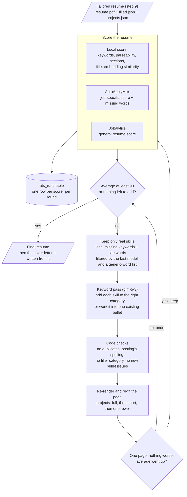

# Step 10 — ATS score loop

After the resume is tailored (step 9), the agent scores it the way applicant tracking systems read it, works the
posting's missing skills in where they truthfully fit, and rescores, up to 5 rounds, aiming for an average of 90.
Every score is recorded, and the cover letter is written afterwards from the final resume.

**Gate passed 2026-10-29** (`jobagent step tailor-check` on the 5 step-7 postings, tailoring + ATS loop + cover
letter): every resume and letter passes the step 9 criteria; every score is recorded in `ats_runs`; each scorer
ran 24 times across the 5 jobs with 0 failures. No posting reached the 90 average, so the gap is reported:

| Posting | Average (start → end) | Local | AutoApplyMax | Jobalytics | Gap |
|---|---|---|---|---|---|
| OpenAI | 84.0 → 88.3 | 98.0 | 85 | 82 | 1.7 |
| Palantir | 84.9 → 86.2 | 92.5 | 88 | 78 | 3.8 |
| Amazon | 85.2 | 93.5 | 80 | 82 | 4.8 |
| NVIDIA | 80.5 → 83.5 | 90.6 | 72 | 88 | 6.5 |
| Stripe | 78.9 | 91.6 | 57 | 88 | 11.1 |

The local score is above 90 everywhere. What holds the average down is AutoApplyMax's word overlap (Stripe's
posting is mostly company language: "financial infrastructure", "economic growth") and Jobalytics' general score,
which skills don't move. Closing that gap would mean stuffing non-skill words, which the loop refuses to do.

## Run it

```bash
jobagent tailor outputs/<company>/<job-id> <slug>               # step 9 + this loop + cover letter (default)
jobagent ats-loop outputs/<company>/<job-id> <slug> [--target 90]   # the loop on an already-tailored resume
jobagent ats outputs/<company>/<job-id>                        # one round of online scores, recorded
jobagent ats-record outputs/<company>/<job-id> skillsfirst 92  # a score you got by hand; joins the average
```

## How it works



The loop runs at most 5 rounds. A model error or a rejected change costs one round; after a model error the
next round tries with fewer keywords.

## The scorers (online only, since 2026-10-29)

The agent's own local scorer was removed at the user's request: every score now comes from an online ATS checker.

| Site | Automated? | What it measures |
|---|---|---|
| AutoApplyMax | yes (agent account) | Job-specific: keywords 40%, formatting, completeness, readability; matched and missing words (word overlap) |
| Jobalytics | yes (agent account) | General resume quality: content, sections, ATS essentials (job match locked) |
| HireFlow | yes (no account) | Job match: keyword match, skills fit, experience fit, completeness; missing must-have / nice-to-have phrases |
| ResumeAtlas | on request only | Required skills shown in work bullets; only 2 job matches a month |
| ATS Friendly | needs an account (asked) | Job match after "Start Scan" |
| SkillsFirst, Jobscan, SkillSyncer, AtsAlign, Novoresume, RemoWork, Lessie | no: their terms forbid bots or scraping | Run by hand; `jobagent ats-record` |
| ApplyCove, Resmume | no: CAPTCHA on every scan | Run by hand; `jobagent ats-record` |

Scores the user records by hand count in the average for the exact resume version they scanned.

## Rules

| Rule | Where |
|---|---|
| A generic word (salary, location, build, tools, information, …) never becomes a skill | `tailor.is_generic` |
| A skill already in any category is not added again; the posting's spelling is used ("Rust", "AWS") | `tailor.apply_keyword_pass` |
| No filler category ("Technical Skills", "Other"), at most 8 categories | `tailor.apply_keyword_pass` |
| A change is kept only if the page stays one page, no bullet issue or uncovered item is added, and the average rises | `steps/ats.run` |
| Work phrases from a site ("leading small projects independently") go into an existing bullet; eligibility (years, degree, authorisation) is never written in | `steps/ats.evaluate`, keyword prompt |
| Projects make room first (short paragraphs, then one fewer, at least 2) | `projects.fit` |
| Every score of every round is recorded | `ats_runs` (`tools/ats_sites.record`) |

## Learned while building

- The free "no login" checkers only score against a job description after a free sign-up.
- The resume header's icon font extracted as junk characters for every ATS; the templates give the icons empty
  "actual text" (`accsupp`), and the loop re-renders older resumes with the fixed template.
- AutoApplyMax's "missing keywords" are mostly boilerplate (posted, salary, workday); without filtering, the
  keyword pass tried to add them, and once added "build, tools, information" as skills.
- `glm-5-3` in json_schema mode spent its whole 16k-token budget deliberating over a handful of keywords;
  in function-calling mode it answers in about 100 s. The fast model was quick but put "rust" under LLMs.
- A full page leaves no room for one more skill: the loop re-fits the projects saved in `projects.json`.
- The 90 average is hard to reach honestly: the local score reaches the high 90s, but AutoApplyMax's word overlap
  and Jobalytics' general score don't respond to skills, so the gap is reported instead of stuffing words.
