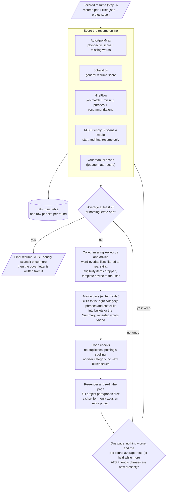

# Step 10 — ATS score loop

After the resume is tailored (step 9), the agent scores it on online ATS checkers, works the posting's missing
keywords and the checkers' own advice in where they truthfully fit, and rescores, up to 5 rounds, aiming for an
average of 90.
Every score is recorded, and the cover letter is written afterwards from the final resume.

> **Current state (2026-11-02).** The resume builder is the **multi-agent team with devstral2-123b for every agent**
> (`jobagent tailor`; section agents + a validator + the ATS router, see "Multi-agent builder" below). It is scored
> every round on AutoApplyMax, Jobalytics and HireFlow (HireFlow averaged over 2 runs). No setup has reached a 90
> average on any posting: best builders score 77.8-79.5 over the 3 entry-level test postings; AutoApplyMax reaches
> 85-90 and Jobalytics 87-90, HireFlow stays at 53-70. Comparing the same-model team with a hybrid team (different
> model per agent) is deferred to plan step 10b. The sections below are in the order the work happened; later
> sections supersede earlier ones where they disagree.

**Gate passed 2026-10-29** (`jobagent step tailor-check` on the 5 step-7 postings, tailoring + ATS loop + cover
letter): every resume and letter passes the step 9 criteria; every score is recorded in `ats_runs`; each scorer
ran 24 times across the 5 jobs with 0 failures. No posting reached the 90 average, so the gap is reported:

| Posting | Average (start → end) | Local | AutoApplyMax | Jobalytics | Gap |
|---|---|---|---|---|---|
| OpenAI | 84.0 → 88.3 | 98.0 | 85 | 82 | 1.7 |
| Palantir | 84.9 → 86.2 | 92.5 | 88 | 78 | 3.8 |
| Amazon | 85.2 | 93.5 | 80 | 82 | 4.8 |
| NVIDIA | 80.5 → 83.5 | 90.6 | 72 | 88 | 6.5 |
| Stripe | 78.9 | 91.6 | 57 | 88 | 11.1 |

The local score is above 90 everywhere. What holds the average down is AutoApplyMax's word overlap (Stripe's
posting is mostly company language: "financial infrastructure", "economic growth") and Jobalytics' general score,
which skills don't move. Closing that gap would mean stuffing non-skill words, which the loop refuses to do.

**Advice loop (2026-10-29, OpenAI Fraud Engineering):** with the sites' advice worked in, the average went
65.6 -> 70.5 (ATS Friendly 38 -> 58, rescanned on the final resume; Jobalytics 84 -> 90; AutoApplyMax 82 -> 81;
HireFlow 58.5 -> 53, the mean of two runs). Gap 19.5. What is left is eligibility or noise, not missing work:
HireFlow keeps asking for "5 years of software engineering" and "2 years of fraud analysis" (its own advice is to
write "Over 5 years ..."), and ATS Friendly wants a Computer Science degree, the posting's exact title and a
city/state in the header (a locked template part, reported to the user).

## Run it

```bash
jobagent tailor outputs/<company>/<job-id> <slug>               # agent team (+ ATS loop) + cover letter (default)
jobagent tailor outputs/<company>/<job-id> <slug> --single      # one-model step 9 + the advice loop below
jobagent multi-agent <job_dir>:<slug> ... [--same-model M] [--role agent=model] [--no-ats]   # experiment runs
jobagent model-experiment <job_dir>:<slug> ... [--model M] [--workers 6]   # every Voyager model, same harness
jobagent ats-loop outputs/<company>/<job-id> <slug> [--target 90]   # the advice loop on an already-tailored resume
jobagent ats outputs/<company>/<job-id>                        # one round of online scores, recorded
jobagent ats-record outputs/<company>/<job-id> skillsfirst 92  # a score you got by hand; joins the average
```

## How it works



The loop runs at most 5 rounds. A model error or a rejected change costs one round; after a model error the
next round tries with fewer keywords.

## The scorers (online only, since 2026-10-29)

The agent's own local scorer was removed at the user's request: every score now comes from an online ATS checker.

| Site | Automated? | What it measures |
|---|---|---|
| AutoApplyMax | yes (agent account) | Job-specific: keywords 40%, formatting, completeness, readability; matched and missing words (word overlap) |
| Jobalytics | yes (agent account) | General resume quality: content, sections, ATS essentials (job match locked) |
| HireFlow | yes (no account) | Job match: keyword match, skills fit, experience fit, completeness; missing must-have / nice-to-have phrases |
| ResumeAtlas | on request only | Required skills shown in work bullets; only 2 job matches a month |
| ATS Friendly | yes (agent account via Google, 2026-10-29); 2 free scans a week, so start + final only, and a scan of the exact same PDF is reused | Job match: missing hard skills, soft skills and other keywords; job title, contact details, education notes |
| SkillsFirst, Jobscan, SkillSyncer, AtsAlign, Novoresume, RemoWork, Lessie | no: their terms forbid bots or scraping | Run by hand; `jobagent ats-record` |
| ApplyCove, Resmume | no: CAPTCHA on every scan | Run by hand; `jobagent ats-record` |
| GotResumeBuilder, Resume Match Lab, CV Analyzer AI, Resume Worded, JobShinobi | no: no job-description form to automate, or unclear terms on automated use | Not used |
| ResyMatch | not built: about 5 free credits in total, too few for a per-round loop | Not used |
| Resume Optimizer Pro | in the user's first pick, never built (no reason recorded) | Not used |

About 21 sites were looked at; 5 are automated, and only AutoApplyMax, Jobalytics and HireFlow are free with no scan
cap, allow automated use and show no CAPTCHA, so they are the ones every experiment uses. The user wanted the
terms-forbidding sites automated anyway; that was declined because it breaks their terms of service. Scores the user
records by hand count in the average for the exact resume version they scanned.

## Rules

| Rule | Where |
|---|---|
| A generic word (salary, location, build, tools, information, …) never becomes a skill | `tailor.is_generic` |
| A skill already in any category is not added again; the posting's spelling is used ("Rust", "AWS") | `tailor.apply_keyword_pass` |
| No filler category ("Technical Skills", "Other"), at most 8 categories | `tailor.apply_keyword_pass` |
| A change is kept only if the page stays one page, no bullet issue or uncovered item is added, and the average rises | `steps/ats.run` |
| Work phrases from a site ("leading small projects independently") go into an existing bullet. Since 2026-10-29 (claims policy) years and domain experience are written in up to the declared total (`claims.years_experience: 5`); credentials (certifications, clearance, PhD), citizenship/work authorization and location never are | `steps/ats.ELIGIBILITY`, keyword prompt |
| Projects: full paragraphs first, a 2-line short form only adds an extra project, at least 2 (`P.layouts`); the multi-agent space planner also drops 4th bullets before shortening a project | `projects.fit`, `multi_agent.plan_space` |
| Words for whoever applies (applicants, candidate, people, you, employment) are never written in; other non-generic AutoApplyMax words (finance, compliance, product, AWS) may go into the Summary, bullets, skills or project descriptions | `steps/ats.APPLICANT_WORDS` |
| A change that makes the rendered page read worse (layout issues up) is rejected before scoring | `steps/ats.run`, `tools/layout.py` |
| Every score of every round is recorded | `ats_runs` (`tools/ats_sites.record`) |
| Advice about credentials, work authorization or location is dropped; header advice (hidden links) is logged for the user, never applied. City/state/country is never added to the header and no longer reported (the user doesn't want proximity screening). ATS Friendly's job-title and degree-field notes are advice (the Summary opens with the posting's title; the B.Tech in Computer Science is real) | `steps/ats.evaluate`, `ats_sites.atsfriendly` |
| Soft skills are shown through the work in bullets or the Summary, never listed in Technical Skills | keyword prompt |
| The Summary may be rewritten (80-500 characters, same facts) | `tailor.apply_keyword_pass` |
| Every site gets the PDF as `First_Middle_Last_Resume.pdf` (Jobalytics flags `resume.pdf`) | `ats_sites.upload_name` |

## Learned while building

- The free "no login" checkers only score against a job description after a free sign-up.
- The resume header's icon font extracted as junk characters for every ATS; the templates give the icons empty
  "actual text" (`accsupp`), and the loop re-renders older resumes with the fixed template.
- AutoApplyMax's "missing keywords" are mostly boilerplate (posted, salary, workday); without filtering, the
  keyword pass tried to add them, and once added "build, tools, information" as skills.
- `glm-5-3` in json_schema mode spent its whole 16k-token budget deliberating over a handful of keywords;
  in function-calling mode it answers in about 100 s. The fast model was quick but put "rust" under LLMs.
- A full page leaves no room for one more skill: the loop re-fits the projects saved in `projects.json`.
- The 90 average is hard to reach honestly with online checkers: AutoApplyMax's word overlap
  HireFlow's exact-phrase keyword match (8-14%) and Jobalytics' general score don't respond to real skills; the
  first online-only run on OpenAI went 73.0 -> 74.7 (AutoApplyMax 82, Jobalytics 82, HireFlow 60).
- HireFlow's fit scores come from a model: the same unchanged resume scored 52, 57, 60 and 64. Judging an edit by
  one run kept or undid changes at random, so HireFlow is scored twice and averaged, and a change that works in
  2+ of ATS Friendly's phrases is kept unless the per-round average falls by more than 2 points.
- Rewrites dropped words AutoApplyMax already matched ("compliance", "security") and lengthened sentences
  (readability 90 -> 82); the advice pass now gets a KEEP list and may not make a line longer.
- The keyword pass added "backend systems" under "Backend and Data Systems" and "fraud remediation" next to "fraud
  detection and remediation"; multi-word terms already said by the category or one term are refused
  (`tailor.covered_by`). One-word tools always stay ("Azure" next to "Azure DevOps CI/CD").
- glm-5-3 sometimes answers a function call with nothing (about 1 round in 3 with the longer advice prompt);
  an empty answer is retried once, then the round is spent with fewer keywords next time.
- ATS Friendly allows 2 free scans a week: it is read at round 0 and rescanned on the final resume, a scan of the
  exact same PDF is reused from `ats_runs`, and with no scans left it is skipped and left out of the final
  average (logged).

## Model experiment (2026-10-29/30)

`jobagent model-experiment outputs/openai/3c67f712-... openai --workers 6`: all 37 Voyager chat models, each writing the
OpenAI Fraud Engineering resume with the same harness (5 tailoring rounds, then the ATS loop: 5 rounds, target 90),
scored on AutoApplyMax, Jobalytics and HireFlow (2 runs). About 9.5 hours wall time. Full table:
`outputs/experiments/20261029-1942-openai/results.md`.

| Model | Average | AutoApplyMax | Jobalytics | HireFlow | Minutes |
|---|---|---|---|---|---|
| qwen3-coder-next | 81.3 | 87 | 90 | 67.0 | 104 |
| qwen35-27b | 80.5 | 85 | 90 | 66.5 | 102 |
| inkling-small / beam-1-0 / muse-spark-open | 80.3 | 85 | 90 | 66.0 | 45 / 157 / 31 |
| glm-5-3-flash | 79.7 | 85 | 90 | 64.0 | 44 |
| devstral2-123b / olmo3-7b | 79.0 | 87 / 86 | 90 | 60 / 61 | 4 / 6 |
| glm-5-3 (default) | 78.8 | 79 | 90 | 67.5 | 46 |

- No model reached 90. The scorers set the ceiling, not the models: Jobalytics tops out at 90 (a general score),
  AutoApplyMax at 87, and HireFlow at 67.5 for every model (its keyword match stays near 14%). The best possible
  average with these three is about 81-82, and the top 10 models are within 2.5 points, inside HireFlow's
  run-to-run noise.
- 2 models (qwen3-coder-30b-a3b-instruct, qwen3-30b-a3b) ended on 2 pages: disqualified.
- 7 models never produced a tailored resume: 5 timed out (600 s, retried once) on every tailoring round under
  6-way load (kimi-k2-7-code, north-mini-code, qwen-agentworld-35b-a3b, qwen35-122b-a10b, qwen35-397b-a17b);
  minimax-m3 gave empty or unparseable structured output; ornith-1-5-35b-a3b ran out of tokens.


## Text extraction, bullets and layout (2026-10-31)

**OCR.** The top experiment resume (qwen3-coder-next) rendered to an image and read three ways:

| Extractor | Where | Time / fit | Result |
|---|---|---|---|
| PDF text layer (`pdftotext`, what most checkers read) | container | instant | Clean: every font maps to Unicode, bullets are "•", header icons carry empty ActualText |
| Tesseract 5.5 (300 dpi) | container | 3.3 s | Body text right; the tiny bullet reads as "¢", header icons as junk ("oJ /623-...", "%/bshah43@...") |
| glm-ocr (Ollama, 150 dpi) | GTX 1650 4 GB | 62 s, 3.5 GB peak, 100% GPU | Near perfect (bullets "•", icons dropped); 200 dpi runs out of GPU memory |
| deepseek-ocr (Ollama) | GTX 1650 4 GB | does not fit | CUDA out of memory even at 150 dpi (needs a further 1.6 GB buffer) |

A good OCR reads the resume correctly, so extraction is not what holds scores down.

**Bullets.** Nine variants on Jobalytics (tiny / normal / small bullet, hyphen, no final period, periods on skills
lines, one-line bullets, no Projects) all scored 90 with exactly one "Bullets Consistency" issue, and so did a
plain control resume with eight identical, capitalised, period-ended bullets: that issue is constant on the free
checker. It is no longer passed to the model as advice. The tiny bullet stays (text layer "•"); a hyphen would read
best for Tesseract-style OCR.

**Layout validator** (`tools/layout.py`): checks the rendered page, not the LaTeX: one page; free height at the
bottom (LaTeX logs `\pagegoal - \pagetotal` on every compile); bullets whose last line holds 1-3 words; uneven
bullet gaps; Technical Skills lines under 60% full; one-line project descriptions. On the 37-model OpenAI run it
flagged what a reader sees: one-line projects (devstral2-123b 3, gemma4-31b-it 4), 4 blank lines (olmo3-7b,
gemma4-31b-it), skills lines filling 5-16% of the width. A vision model then reviews the page image with a
checklist; qwen38-27b (about 50 s) found the same problems as the code checks, gemma4-31b-it was faster (2-9 s) but
found fewer, qwen36-27b timed out. Both vision models also reported blank space on a page LaTeX logged as full, so
only the findings code can't measure (odd characters, overlap, overflow, alignment) are fed back.

**Projects.** The prompt had no example and allowed 2-3 sentences; the page fitter shortened every project to one
sentence before dropping one. Now: a worked example, exactly 3 sentences (problem, system, wow factor), short
paragraphs and duplicate projects sent back, and the fitter keeps full paragraphs (a short form only adds an extra
project).

**Word policy.** AutoApplyMax's missing words that aren't generic (finance, compliance, product, AWS) are worked
into the Summary, bullets, skills or project descriptions, and kept only if the scores rise; words for whoever
applies (applicants, candidate, people, you, employment) never are.

## Second model experiment cancelled (2026-11-01)

37 models x 3 entry-level postings (DoorDash SWE, Adobe ML, Symbotic Robotics), stopped by the user after 14 models
(20 hours). Conclusion: **a single LLM writing the whole resume fails**: no model reached 90 (best devstral2-123b
79.5 average) and the resumes kept problems no generation pass caught: too few bullets with room left, template
bullets and skills unused, short or wrong project descriptions, too few or weaker projects, an empty skills line, an
over-long page. Details and evidence: `outputs/experiments/20261031-1910-doordash-adobe-symbotic/CONCLUSION.md`.
Next: the multi-agent builder with a validator agent that checks against that list and routes ATS advice.

## Multi-agent builder (2026-11-01/02)

`jobagent multi-agent <job_dir>:<slug> ... [--same-model M]` (`steps/multi_agent.py`, LangGraph): section agents
(experience, projects, skills, summary), a validator (one page, bullet rules, JD coverage, space planner, rendered-page
checks, Summary checks, content review, vision review) and an ATS router that sends each site's missing words and
advice to the agent owning that section. A version with a hard issue (not one page, a one-line project, a blank band at
the bottom, an empty skills line) can't be kept, whatever its score. Same 3 postings as the cancelled model run:

| Variant | DoorDash | Adobe | Symbotic | Average | Hard issues |
|---|---|---|---|---|---|
| Single model devstral2-123b (cancelled run) | 75.7 | 78.2 | 84.5 | 79.5 | the user's review list |
| Agents, same model (devstral2-123b) | 76.3 | 76.8 | 81.8 | 78.3 | none |
| Agents, different models (devstral2-123b, gpt-oss-120b, glm-5-3-flash, llama4-scout-17b, glm-5-3) | 74.3 | 77.3 | 81.8 | 77.8 | none |

No variant reached 90: AutoApplyMax reached 85-90 and Jobalytics 87-90, but HireFlow stayed at 53-70. The agents
keep the page clean where the single model didn't, at about the same score. Lessons: the validator must also check
the Summary (llama4-scout-17b as the summary agent copied the posting's requirement list and overflowed the page);
a model that hangs in one structured-output mode is remembered so it costs one timeout, not one per call; the space
planner (full projects before extra bullets) is what stopped the 2-short-projects pattern. Results:
`outputs/experiments/20261101-1949-multiagent-same-devstral2-123b/`, `20261101-2339-multiagent-team/` (Adobe,
Symbotic) and `20261102-0310-multiagent-team/` (DoorDash rerun).

### The multi-agent runs, folder by folder

All under `outputs/experiments/`, postings DoorDash Software Engineer I, Adobe 2027 University Graduate ML Engineer,
Symbotic Robotics Planning Engineer (All Levels). "Team" = experience devstral2-123b, projects gpt-oss-120b, skills
glm-5-3-flash, summary llama4-scout-17b, validator/router glm-5-3. "Same" = devstral2-123b for everything.

| Folder | What it was | Outcome |
|---|---|---|
| `20261031-1746-multiagent` | First dry run (no ATS sites), first design, provisional team (qwen3-coder-next, laguna-s-2-1, qwen35-27b, glm-5-3), DoorDash | Worked end to end; qwen35-27b took 190-816 s per skills call; the experience agent rewrote every bullet on each pass (then: targeted edits, a skills size budget) |
| `20261101-1539-multiagent` | Dry run of validator v1 (the user's review list), same model, DoorDash | Findings 22 -> 9; the content review never ran and findings weren't logged (both fixed) |
| `20261101-1605-multiagent-team` | First full run with ATS, validator v1 | Stopped ~19:50: blank space and short projects (validator rules conflicted, no gate); Symbotic 82.7 |
| `20261101-1605-multiagent-same-devstral2-123b` | Same-model counterpart | 82.0 (overstated: HireFlow failed, averaged over 2 sites) / 72.2 / 81.7; same problems |
| `20261101-1931-multiagent-same-devstral2-123b` | Dry run of the space planner, DoorDash | Page filled, 3 projects; the short form printed as one line (then: 2-line short form) |
| `20261101-1948-multiagent-team` | Team rerun with space planner + gate | Stopped ~23:40: every experience call hung 20 min in json_schema mode (then: hung modes remembered, no client retry) |
| **`20261101-1949-multiagent-same-devstral2-123b`** | Same model with space planner + gate | **76.3 / 76.8 / 81.8 (78.3)**, one page, no hard issues; the user's chosen builder (Symbotic's projects still short, below) |
| `20261101-2339-multiagent-team` | Team after the hang fix | Adobe 77.3, Symbotic 81.8; DoorDash never fit one page (its PDF there is a leftover draft) |
| `20261102-0310-multiagent-team` | Team, DoorDash only, after the Summary checks | 74.3, one page |

### Why some resumes still had short project descriptions

`20261101-1949-...-same.../symbotic` and `20261101-2339-multiagent-team/adobe` kept 2 projects, both in their short
form (166-216 characters), while DoorDash and Adobe in the same-model run kept 2 in full (384-454 characters). The
cause was the Summary: 588 and 577 characters (4-5 lines) against 429 for the good Adobe resume; those runs predate
the Summary checks, the space planner can't trim bullets below 3 per role (all roles were at 3) and can't shorten
the Summary, so the fitter fell back to two short projects, and the gate only treated a one-line description as a
hard issue (these printed as two lines). Fixed 2026-11-02: fewer than 2 projects in full is a hard issue, and when
projects are squeezed the Summary agent is told to cut to 300 characters and the skills agent to one line per
category. The team's llama4-scout-17b also ignored the Summary limit pass after pass; the team's Summary agent is now
devstral2-123b. The bare-repo-title check exempts the template's own titles (it flagged "CloudForge", which the
projects prompt says to keep).

### Decision (2026-11-02)

The user liked the same-model resumes (`20261101-1949-multiagent-same-devstral2-123b`, DoorDash and Adobe) and chose
that setup as the builder: `jobagent tailor` = multi-agent team with devstral2-123b for every agent, then the cover
letter; `settings.model_writer` defaults to devstral2-123b. Finishing the same-model vs hybrid comparison (quality
and speed) is plan step 10b, after the core steps. Earlier single-model findings: the cancelled 37-model run's
`CONCLUSION.md` and `SECTIONS.md` (per-section strengths used to pick the hybrid team).

### What still blocks a 90 average

HireFlow (53-70 on every builder and model): its keyword match counts the posting's exact phrases ("Experience with
Terraform", "2 years experience in fraud or abuse analysis") and its fit scores are model judgements that vary by
about ±4 on an unchanged resume. Jobalytics stops at 90 (a general score with a constant "Bullets Consistency" issue);
AutoApplyMax reaches 85-95. Ideas not yet tried: making HireFlow's exact phrases mandatory insertions, or adding a
hand-scanned checker (`jobagent ats-record`) so HireFlow weighs less in the average.

