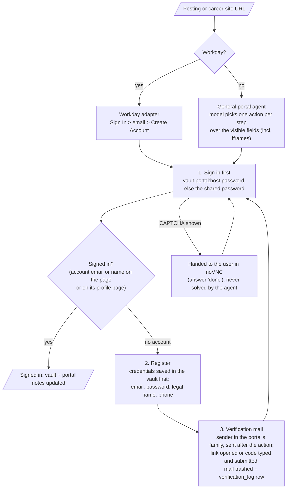

# Step 11 — Portal sign-in and registration

Before an application is filled (step 12), the agent must be signed in to the employer's job portal with its own
email (`bhavya24091952@gmail.com`). It signs in first; it registers only when the portal has no account for that
email; it never resets a password and never registers twice on the same portal.

**Status (2026-11-02):** Workday (Adobe, Symbotic), Lever and Amazon's own portal pass: account created, email
confirmed from the inbox, the used verification mail moved to Trash with an audit row, and a second run with the
session cleared signs in with the stored password without registering again. Oracle Cloud (JPMorgan) and iCIMS
(General Dynamics) show an hCaptcha puzzle after the email is submitted, so they need the user in noVNC.

## Run it

```bash
jobagent portal-login <posting or career-site URL>          # sign in (register the first time)
jobagent portal-login --fresh <URL>                        # forget the site's session first: a real sign-in
```

## How it works



## Credentials

| What | Where |
|---|---|
| Shared password for every portal (user's choice, so sign-in works the first time) | vault `portal_default` (`state/vault.enc`, encrypted) |
| Each portal: email, password used there, account / verified flags, dates | vault `portal:<host>` |
| A portal that refuses the shared password (too weak / common) gets its own strong password, saved before it's typed | `portal:<host>` (`note` says so); Amazon is one |
| Lever / Greenhouse: no account needed (the posting's form takes applications directly) | `portal:<host>` `no_account: true` |

## Rules

| Rule | Where |
|---|---|
| Sign in before registering; register only when the portal says no account exists; a used verification mail proves an account exists, so never register twice; never reset a password | `portal_auth.ensure_account` |
| Only fields a person would fill are filled: hidden fields (honeypots) are never listed to the model | `portal_agent.SNAPSHOT_JS` |
| The model types placeholders only: `{EMAIL}`, `{PASSWORD}`, `{ALT_PASSWORD}`, `{FIRST_NAME}`, `{LEGAL_FIRST_NAME}`, `{LAST_NAME}`, `{PHONE}`, `{CODE}`; a password only into a password field | `portal_agent.run` |
| "Signed in" only with proof: the account email or first name on the page, or on the site's own profile page (a "Sign out" link isn't proof) | `portal_agent.signed_in_evidence` |
| A visible CAPTCHA (also inside a portal's iframe) goes to the user; a hidden pre-loaded one doesn't; a puzzle that keeps coming back stops the run | `challenge.detect`, `portal_agent.run` |
| The same action three times stops the run with a screenshot (`state/logs/portal-stuck-<host>.png`) | `portal_agent.run` |
| Verification mail: sender domain in the portal's family (e.g. Workday tenants mail from myworkday.com, amazon.jobs from amazon.dev) and sent after the agent's action; used mail trashed with a `verification_log` row; nothing else is touched | `inbox.wait_for_verification`, `db.ATS_SENDER_FAMILIES` |

## Portal survey (`asu_contacts.csv`, top 120 companies)

| Platform | Companies | Account to apply |
|---|---|---|
| Workday | 35 (Bank of America, USAA, AT&T, Intel, Micron, Wells Fargo, Adobe, ...) | yes, one per employer |
| Oracle Cloud / Taleo | 13 (BAE, JPMorgan Chase, Oracle, Goldman Sachs, Chubb, ...) | yes |
| iCIMS | 5 (General Dynamics Mission Systems, Discount Tire, Exponent, ...) | yes |
| Paylocity, SmartRecruiters, Jobvite, Avature (Cisco), ADP, BrassRing, Dayforce, Greenhouse | 1-4 each | varies |
| Company's own portal / not identifiable from search | 54 (Amazon, Meta, Verizon, IBM, Yelp, ...) | varies |

## Learned while building

- Workday: the first run did create the Adobe account, but the code read Workday's screen-reader status ("Search for
  Jobs page is loaded") as an error; an unverified account answers "wrong email or password or your account might
  be locked"; after registering, Workday returns to the sign-in choices. Symbotic's tenant needs no email
  confirmation. "Create Account" is reliably submitted with Enter in the last field.
- iCIMS and Oracle Cloud show an hCaptcha puzzle after the email is submitted. hCaptcha closes by itself after a
  while and re-appears on every submit, so the user must say when it's solved.
- Oracle pre-loads a full-size hCaptcha frame hidden with opacity 0: only a frame that's really shown counts.
- amazon.jobs: "My career" menu shows "Sign out" even when signed out; the codes come from amazon.dev in six
  one-digit boxes; it refused the shared password as a new password; its sign-in service (on amazon.com) remembers
  the browser, so a later sign-in may skip the password.
- **Inbox date bug:** the verification wait searched `SINCE <UTC date>`, but Gmail compares its own (Pacific)
  calendar date, so every code arriving after about 5 pm Arizona time was invisible. It now searches from the day
  before and checks each message's own timestamp.
- The model often says "click Continue" but re-sends the same fill: a repeated fill becomes Enter; an entered code
  is submitted by code.
