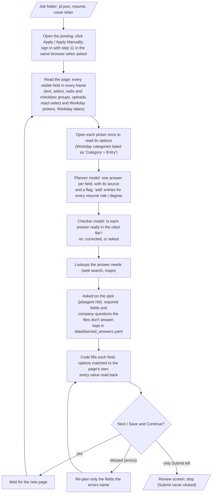

# Step 12 — Application forms

The agent fills a job's application up to its review screen, reads every field back, and stops: it never clicks
Submit (the user approves and submits in step 13).

## Run it

```bash
jobagent apply outputs/<company>/<job-id> <company-slug>               # e.g. outputs/doordash/8163709 doordash
jobagent apply ... --ask-minutes 5                                     # how long a question waits for you (default 30)
jobagent apply ... --model qwen35-397b-a17b                            # another Voyager model plans the answers
jobagent hitl answer <id> '<answer>'                                   # answer a question the agent asks on the spot
```

The job folder needs `jd.json` (step 7), `resume.pdf` / `resume.tex` (step 9) and, when the form takes one,
`cover_letter.pdf`. The result goes to `outputs/<company>/<job-id>/application/`: `application.md` (every field, the
value the page shows, its source, read back OK or not, flags), `application.json`, and a screenshot per page.

## How it works



## Where answers come from

One file, `data/applicant.yaml` (template: `data/applicant.example.yaml`), holds every answer. It was built from the
unique questions the three test portals asked (Workday: Adobe, 59 fields; Greenhouse: DoorDash, 31; Lever: Palantir,
24 -> 97 distinct labels -> 55 questions) and replaces `personal_info.yaml`, `qa_bank.yaml`, `learned_answers.yaml`
and the form parts of `preferences.yaml`. Each entry has `question`, `seen` (the wordings portals use), `answer`,
`instructions` and `tools` (`web_search`, `maps`); sections: identity, contact, address, links, work authorization,
education, experience, employer history, preferences, sourcing, written answers, consents, self-identification,
documents, and `learned` (answers given on the spot, appended by the agent with company, portal and date).

`apply.hints` matches each form label to its entry (a short wording must equal the label; a long one may be worded
differently or be part of a longer label; fields inside a Work Experience / Education entry go to "Work history" /
"Degrees") and shows the entry next to the field: 122 of the 128 test fields match (the rest are upload boxes,
handled by code, and unlabelled boxes). The experience answers (work history with each role's bullets, current company,
skills, years of experience with overlaps counted once, internships) are taken from the job's tailored `resume.tex`
when its form is filled (`applicant.resume_experience`, `applicant.with_resume`), so the form says what the uploaded
resume says. Written answers come from the resume and the company profile (step 8).

Two facts are enforced in code whatever an instruction says (`apply.enforce`): address fields only from the "Current
address" entry (never looked up or made up; empty -> asked), and a referral option only for a `data/targets.csv`
contact with `referral_consent: yes` (otherwise asked).

## Rules

| Rule | Where |
|---|---|
| Submit / Send / Finish / a bare "Apply" on a form page is never clicked | `forms.SUBMIT`, `forms.click_button` |
| Personal facts only from the candidate's files; an empty address is asked for (fill `personal_info.yaml`, answer "done"), never invented | `apply.PROMPT`, `apply.resolve` |
| A field's matching `qa_bank` / learned entry is shown next to it (fuzzy match on the wording) | `apply.hints` |
| Dates are worked out by code (a degree that ended in May 2026 is "graduated" on 2026-11-03), so ranges are compared, not guessed | `apply.date_facts` |
| The checker sends assumed answers (a consent never given, an eligibility, a language) to the candidate; it can't swap the candidate's own file for the resume, and its corrections must be real options | `apply.check` |
| Questions asked on the spot: required fields and company-specific choices; an optional text box with no data stays empty; the answer is appended to `applicant.yaml` `learned` | `apply.resolve`, `applicant.learn` |
| Self-identification `personal_info` doesn't cover: "I don't wish to answer" | `apply.PROMPT` |
| Marketing / SMS / talent-community: declined; consents needed to apply: agreed | `apply.PROMPT`, `qa_bank.yaml` |
| Entries are added only for work experience / education, or a section `personal_info` has data for (no blank Certifications entry) | `apply.ENTRY_OK`, `apply._has_data` |
| A required field left empty is asked about after the page is filled, only if still shown (a current job's To date disappears) | `apply.fill_page` |
| A value is only "verified" when the page shows it after filling (dates by digits, phones by digits, pickers by their chosen items) | `forms.same_value` |

## Results (2026-11-03)

| Portal | Posting | Pages | Fields read back OK | Left for the user |
|---|---|---|---|---|
| Workday | Adobe, 2027 University Graduate ML Engineer | 6 (to the Review page) | 73 / 73 | address (optional on Adobe, left empty) |
| Greenhouse | DoorDash, Software Engineer I | 1 (the form itself) | 28 / 30 | current city (no address on file); internships (the form offers 1 or 2+, the resume shows 0) |
| Lever | Palantir, Backend Software Engineer | 1 | 22 / 24 | current location; eligibility for the UK clearance (empty in applicant.yaml) |

Every field the agent could answer from the files reads back as planned; the ones left are questions only the user
can answer (asked through `jobagent hitl`, not answered during the test runs).

Open for the user: the current address (empty in `personal_info.yaml`), the ASU GPA (`personal_info` 4.0 vs the
resume's 3.57), the "How did you hear" entry in `qa_bank.yaml` (answer "Referral" vs its instruction "the company's
own website unless a referral exists"), and a `qa_bank` entry for "willing to submit to a background check"
(answered "Yes" without a file saying so).

## Answer rules added after the filled applicant.yaml run (2026-11-03)

- An answer written as a list of words is a list of variants of one answer, in preference order (degree:
  ["Master of Science", "MS", "Master's degree"]); a search picker gets them joined with " | " and code tries each in
  turn; the checker accepts any variant (`apply.in_applicant`), and degree levels match portal wording ("Masters",
  "Bachelor's Degree").
- A range option holds the file's value: GPA 4.0 -> "3.75+" (`forms.in_range`).
- "How did you hear": the company's own site option when no consenting referral is on file (`apply.own_site_option`).
- Address fields: never from a lookup; enforced before and after lookups.
- Repeated entries: at most one per resume role / degree on file (`apply.entry_room`).
- Skills: only the same name or the same name with a qualifier ("Python (Programming Language)"), never a different
  thing containing it ("Python IDLE", "SAP R") (`forms.strict_option`).
- Uploads by caption; an upload's value is only a file really attached (its caption "ATTACH RESUME/CV" isn't one).
- Fields the planner skips get a second, smaller planning call; a field the page already shows right isn't refilled;
  Workday dates are retyped when they don't take; clicks don't wait for slow navigations (Lever).

## Learned while building

- react-select (Greenhouse) shrinks its input to nothing once a value is chosen: a combobox is judged visible by its
  control box, and its value read from the `single-value` element.
- Lever writes button text in capitals with CSS ("APPLY") while the accessible name is "Apply": buttons are matched
  without case. Lever puts each question in a sibling element: a field's question is the nearest container text
  minus its own options.
- Workday: header controls (language menu) aren't form fields; "Select One" list buttons are `type=button`; a list
  button's `aria-label` holds its value, so the form field's own label is used; dates are zero-size month / year
  inputs drawn next to their text, filled by typing digits; search pickers (`selectinput`) search on Enter and keep
  chosen items in a separate list; "How did you hear" is two levels (category, then entry); one question's checkboxes
  each have their own name; every work-experience entry repeats the same checkbox name; a new page shows a
  placeholder first, so the agent waits until the headings change.
- A refused Next re-plans only the fields the errors name; nothing is asked twice.
- The planner (devstral2-123b) credits answers to files that don't hold them (a language, a background-check "yes",
  "no competing offers"): the checker pass catches these and asks.
