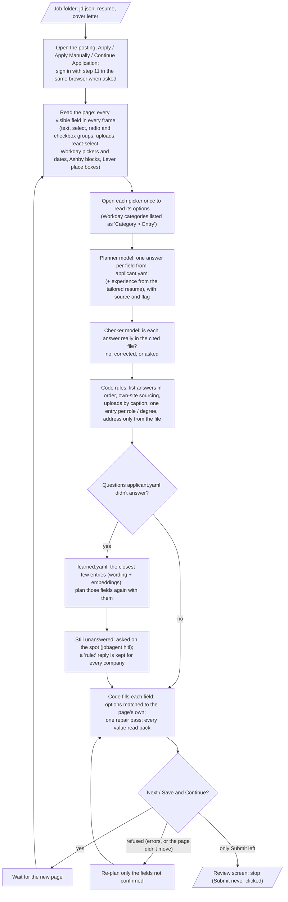

# Step 12 — Application forms

The agent fills a job's application up to its review screen, reads every field back, and stops: it never clicks
Submit (the user approves and submits in step 13).

**Status (2026-11-05): done.** Five postings on four platforms reach their review screen with every field the
candidate's files answer read back correctly (table below); the rest are questions only the candidate can answer.

## Run it

```bash
jobagent apply outputs/<company>/<job-id> <company-slug>               # e.g. outputs/doordash/8163709 doordash
jobagent apply ... --ask-minutes 5                                     # how long a question waits for you (default 30)
jobagent apply ... --model qwen35-397b-a17b                            # another Voyager model plans the answers
jobagent hitl answer <id> '<answer>'                                   # answer a question the agent asks on the spot
jobagent hitl answer <id> 'rule: <how to answer questions like this>'  # teach it for every company
jobagent learned ["<question>"]                                        # what it learned / would look up for a question
```

The job folder needs `jd.json` (step 7), `resume.pdf` / `resume.tex` (step 9) and, when the form takes one,
`cover_letter.pdf`. The result goes to `outputs/<company>/<job-id>/application/`: `application.md` (every field, the
value the page shows, its source, read back OK or not, flags), `application.json`, and a screenshot per page.

## How it works



## Where answers come from

| Source | Used for |
|---|---|
| `data/applicant.yaml` (template `applicant.example.yaml`) | everything about the candidate; only the candidate edits it. Built from the unique questions of Workday, Greenhouse and Lever forms: entries of `question`, `seen` (portal wordings), `answer` (a list = accepted wordings in order), `instructions`, `tools` |
| the job's `resume.tex` / `resume.pdf` | work history (with bullets), current company, skills, years, internships (`applicant.with_resume`); written answers |
| `data/learned.yaml` | only for questions applicant.yaml doesn't answer: the closest few entries (`learned.relevant`); written by the agent from on-the-spot replies (locked, backed up, validated) |
| `jd.json` / `jd.md`, `state/companies/<slug>.md` | job context; "Why this company?" |
| `data/targets.csv` | a referral, only with `referral_consent: yes` |

The planner prompt is about 28k characters per page (applicant.yaml ~16k, resume, JD, company profile) and does not
grow with what the agent learns.

## Rules

| Rule | Where |
|---|---|
| Submit / Send / Finish / a bare "Apply" on a form page is never clicked | `forms.SUBMIT`, `forms.click_button` |
| Personal facts only from applicant.yaml; address fields only from its "Current address" entry (empty: asked, never looked up or made up) | `apply.PROMPT`, `apply.enforce` |
| "How did you hear": a referral (the Referral option, or "Referred by <name>" in a text box) only for a `data/targets.csv` contact at that company with `referral_consent: yes`; otherwise the candidate is asked on the spot (their answer is kept for that company) | `apply.referral`, `apply.enforce` |
| The job's own location (`locations_resolved`, step 8: "Corporate Headquarters" -> its city) is shown to the planner as JOB_LOCATION for "which location are you applying for"; never used as the candidate's address | `apply.context`, `tools/places.py` |
| A "Cover letter" text box gets the job's cover letter text | `apply.cover_letter_text` |
| Choice buttons (Ashby's Yes / No, `aria-pressed`) are one choice field; the matching button is pressed | `forms.FIELDS_JS`, `forms.fill_field` |
| A list answer is tried in the candidate's order; the closest option only when none is offered; a field holding a later variant ("Other") is improved | `apply.apply_variants`, `forms.close_option`, `forms.lower_variant` |
| A field is left alone only when it really shows the answer (never "United States Minor Outlying Islands" for "United States") | `forms.already_shows`, `forms.match_option` |
| Dates worked out by code (graduated or not, today, the coming Monday); date fields get dates | `apply.date_facts` |
| The checker sends answers a file doesn't support to the candidate; it can't swap the candidate's file for the resume | `apply.check` |
| One work entry per resume role, one education entry per degree; no blank entries (certifications) | `apply.entry_room`, `apply.ENTRY_OK` |
| Uploads by caption (resume / cover letter); autofill boxes skipped; an upload counts once the page shows the file | `apply.fill_page`, `forms.fill_field` |
| Skills: the same name or the same name with a qualifier, never a different thing containing it | `forms.strict_option` |
| A page that doesn't move after Next is a refusal: one retry of the unconfirmed fields, then `blocked` with a screenshot | `apply.run` |

## Results (2026-11-05, final retest)

| Platform | Posting | Pages | Read back OK | Left for the candidate |
|---|---|---|---|---|
| Workday | Adobe, 2027 University Graduate ML Engineer | 6, to Review | 73 / 73 | none |
| Workday | Intel, AI Software Development Engineer (account created by the agent) | 6, to Review | 70 / 70 | none |
| Greenhouse | DoorDash, Software Engineer I | 1 | 28 / 29 | internships (the form offers 1 or 2+, the resume shows 0) |
| Lever | Palantir, Backend Software Engineer | 1 | 24 / 24 | none |
| Ashby | Mercor, AI Infrastructure Engineer | 1 | 8 / 8 | none (office question answered from a learned rule) |

## Changed after the step was closed (2026-11-05 to 2026-11-07)

- Ashby yes/no button questions were invisible to the extractor (Mercor showed "8/8" with 4 questions unanswered);
  now found and answered (12/12).
- A form ending in a human check ("I'm a human") or a hidden submit input reaches the review screen (step 13).
- "How did you hear" no longer defaults to the company's website: without a referrer on file the candidate is asked.
- `data/applicant.yaml` gained a `volunteering` entry (church / non-profit experience: yes, with `details` in the
  candidate's words used for written answers).
- Job locations given as company jargon are resolved to cities (step 8) and shown to the planner.

## Learned while building

- react-select (Greenhouse) shrinks its input once a value is chosen: judged by its control box; value from
  `single-value`.
- Lever: CSS capitals on buttons ("APPLY"); questions in sibling elements; "Current location" keeps only a picked
  suggestion (`.dropdown-results`), so the city is typed and the matching "Tempe, AZ, USA" picked; slow page loads.
- Workday: header controls aren't fields; list buttons are `type=button` and their aria-label holds the value; dates are
  zero-size inputs; search pickers search on Enter, auto-pick a single result and hold chosen items as chips (cleared
  with Delete on the chip); "How did you hear" is two levels; one question's checkboxes have their own names; a signed-in
  posting offers "Continue Application"; forms can show a spinner for 30 s; changing the country rebuilds the address
  section; "United States" must never match "United States Minor Outlying Islands".
- Ashby (Mercor): the question is the field block's first label (placeholders "Start typing…" aren't questions); one
  question's checkboxes each have their own name; "Autofill from resume" would overwrite answers.
- The planner (devstral2-123b) credits answers to files that don't hold them; the checker, code rules and a second
  planning call for skipped fields keep the record honest.
