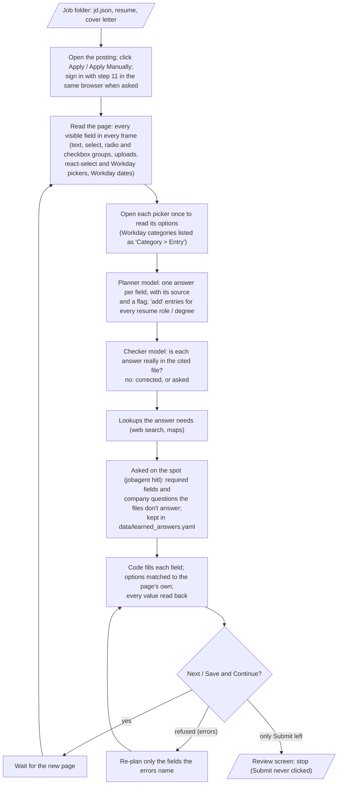

# Step 12 — Application forms

The agent fills a job's application up to its review screen, reads every field back, and stops: it never clicks
Submit (the user approves and submits in step 13).

## Run it

```bash
jobagent apply outputs/<company>/<job-id> <company-slug>               # e.g. outputs/doordash/8163709 doordash
jobagent apply ... --ask-minutes 5                                     # how long a question waits for you (default 30)
jobagent apply ... --model qwen35-397b-a17b                            # another Voyager model plans the answers
jobagent hitl answer <id> '<answer>'                                   # answer a question the agent asks on the spot
```

The job folder needs `jd.json` (step 7), `resume.pdf` / `resume.tex` (step 9) and, when the form takes one,
`cover_letter.pdf`. The result goes to `outputs/<company>/<job-id>/application/`: `application.md` (every field, the
value the page shows, its source, read back OK or not, flags), `application.json`, and a screenshot per page.

## How it works



## Where answers come from

| What | File |
|---|---|
| Name, contact, links, address, education, work authorization, EEO, availability, and Workday's extra personal fields (suffix, phone type, languages, certifications, clearance, previous employment) | `data/personal_info.yaml` |
| How to answer a section's questions, and lookups allowed for it | `agent_instructions` / `tools` keys inside any `personal_info` section |
| Screening questions (authorization, sponsorship, relocation, salary, locations, graduation date, GPA, internships, experience, teams, start date, consents) | `data/qa_bank.yaml` (`answer`, `agent_instructions`, `tools: [web_search, maps]`) |
| Answers you gave on the spot (with the question, options, company, portal, date) | `data/learned_answers.yaml` (written by the agent; edit freely; `company: any` applies everywhere) |
| Work history entries | the tailored resume's Experience section (`RESUME_ROLES`), all roles, in order |
| Written answers ("Why this company?", behavioural questions) | the resume and the company profile (step 8) |
| Years of experience | `master_profile.yaml` `claims.years_experience` (flagged for review) |

## Rules

| Rule | Where |
|---|---|
| Submit / Send / Finish / a bare "Apply" on a form page is never clicked | `forms.SUBMIT`, `forms.click_button` |
| Personal facts only from the candidate's files; an empty address is asked for (fill `personal_info.yaml`, answer "done"), never invented | `apply.PROMPT`, `apply.resolve` |
| A field's matching `qa_bank` / learned entry is shown next to it (fuzzy match on the wording) | `apply.hints` |
| Dates are worked out by code (a degree that ended in May 2026 is "graduated" on 2026-11-03), so ranges are compared, not guessed | `apply.date_facts` |
| The checker sends assumed answers (a consent never given, an eligibility, a language) to the candidate; it can't swap the candidate's own file for the resume, and its corrections must be real options | `apply.check` |
| Questions asked on the spot: required fields and company-specific choices; an optional text box with no data stays empty | `apply.resolve` |
| Self-identification `personal_info` doesn't cover: "I don't wish to answer" | `apply.PROMPT` |
| Marketing / SMS / talent-community: declined; consents needed to apply: agreed | `apply.PROMPT`, `qa_bank.yaml` |
| Entries are added only for work experience / education, or a section `personal_info` has data for (no blank Certifications entry) | `apply.ENTRY_OK`, `apply._has_data` |
| A required field left empty is asked about after the page is filled, only if still shown (a current job's To date disappears) | `apply.fill_page` |
| A value is only "verified" when the page shows it after filling (dates by digits, phones by digits, pickers by their chosen items) | `forms.same_value` |

## Results (2026-11-03)

| Portal | Posting | Pages | Fields read back OK | Stopped at |
|---|---|---|---|---|
| Greenhouse | DoorDash, Software Engineer I | 1 | 29 / 31 (city not on file; GPA asked: files disagree) | review (the filled form, Submit not clicked) |
| Lever | Palantir, Backend Software Engineer | 1 | 21 / 24 (location, UK clearance eligibility, AI-notetaker consent: asked) | review |
| Workday | Adobe, 2027 University Graduate ML Engineer | 6 (My Information, My Experience with 4 roles + 2 degrees, Application Questions 1-2, Voluntary Disclosures, Review) | 73 / 73 | Review page |

Every field the agent could answer from the files reads back as planned; the ones left are questions only the user
can answer (asked through `jobagent hitl`, not answered during the test runs).

Open for the user: the current address (empty in `personal_info.yaml`), the ASU GPA (`personal_info` 4.0 vs the
resume's 3.57), the "How did you hear" entry in `qa_bank.yaml` (answer "Referral" vs its instruction "the company's
own website unless a referral exists"), and a `qa_bank` entry for "willing to submit to a background check"
(answered "Yes" without a file saying so).

## Learned while building

- react-select (Greenhouse) shrinks its input to nothing once a value is chosen: a combobox is judged visible by its
  control box, and its value read from the `single-value` element.
- Lever writes button text in capitals with CSS ("APPLY") while the accessible name is "Apply": buttons are matched
  without case. Lever puts each question in a sibling element: a field's question is the nearest container text
  minus its own options.
- Workday: header controls (language menu) aren't form fields; "Select One" list buttons are `type=button`; a list
  button's `aria-label` holds its value, so the form field's own label is used; dates are zero-size month / year
  inputs drawn next to their text, filled by typing digits; search pickers (`selectinput`) search on Enter and keep
  chosen items in a separate list; "How did you hear" is two levels (category, then entry); one question's checkboxes
  each have their own name; every work-experience entry repeats the same checkbox name; a new page shows a
  placeholder first, so the agent waits until the headings change.
- A refused Next re-plans only the fields the errors name; nothing is asked twice.
- The planner (devstral2-123b) credits answers to files that don't hold them (a language, a background-check "yes",
  "no competing offers"): the checker pass catches these and asks.
