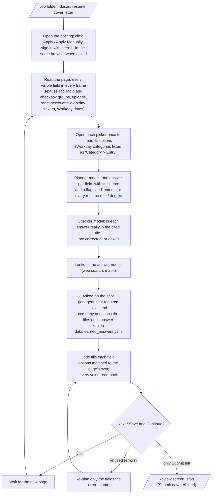

# Step 12 — Application forms

The agent fills a job's application up to its review screen, reads every field back, and stops: it never clicks
Submit (the user approves and submits in step 13).

Startup rejects a careers search screen with a job-search heading and only optional search filters, even if
three or more dropdowns are visible. Those controls are not applicant questions. This also applies after wizard
navigation; the agent stops with an explicit navigation error before planning answers or asking the candidate.
Candidate fields, uploads and application navigation prevent this narrow filter-only classification.

Before planning, the filler opens form disclosures through safe section controls, including a separate Expand all
sections link. It leaves answers unchanged and never clicks a default submit button merely because it looks like
a section heading. Remaining collapsed sections with candidate controls make extraction incomplete and block
readiness; they also prevent startup from mistaking a final Apply button for navigation on an apparently empty form.
Upload icons use their own accessible label references; header language menus remain navigation.

When a portal explicitly requests only the most recent university, the application-local source set selects it
by its provided dates and retains the original source IDs. It neither adds the other schools nor rewrites the
profile. Missing or tied recency and extra existing rows stop for review. Skills in a declared multi-select are
separate choices; a single comma-filled chip is not verified as several selections. Workday upload verification
uses the isolated form field, including its acknowledgement, while retaining dispatched-byte checks.

## Run it

```bash
jobagent apply outputs/<company>/<job-id> <company-slug>               # e.g. outputs/doordash/8163709 doordash
jobagent apply ... --ask-minutes 5                                     # how long a question waits for you (default 30)
jobagent apply ... --model qwen35-397b-a17b                            # another Voyager model plans the answers
jobagent hitl answer <id> '<answer>'                                   # answer a question the agent asks on the spot
```

The job folder needs `jd.json` (step 7), `resume.pdf` / `resume.tex` (step 9) and, when the form takes one,
`cover_letter.pdf`. The result goes to `outputs/<company>/<job-id>/application/`: `application.md` (every field, the
value the page shows, its source, read back OK or not, flags), `application.json`, and a screenshot per page.

## How it works

New applications use source-routed planning by default (`FILLING_STRATEGY=experimental`).
The agent inventories reachable fields and actual choices, creates known repeated entries,
classifies each question and routes its evidence, resolves exact facts locally, batches
remaining generation and missing-answer questions, then fills and verifies. Newly revealed
controls repeat that process. Existing drafts retain their recorded strategy; an explicit
`--filling-strategy` overrides it. See [the current strategy guide](../experiments/production-opt-in.md)
and [the watched Voyager comparison](../experiments/results/form-pipeline-vpn-2026-11-15/REPORT.md).

The following diagram describes the original strategy, retained as an explicit comparison option.



## Where answers come from

Owner answers and policies live in `data/applicant.yaml` (template: `data/applicant.example.yaml`). It was built from the
unique questions the three test portals asked (Workday: Adobe, 59 fields; Greenhouse: DoorDash, 31; Lever: Palantir,
24 -> 97 distinct labels -> 55 questions) and replaces `personal_info.yaml`, `qa_bank.yaml`, `learned_answers.yaml`
and the form parts of `preferences.yaml`. Each entry has `question`, `seen` (the wordings portals use), `answer`,
`instructions` and `tools` (`web_search`, `maps`); sections: identity, contact, address, links, work authorization,
education, experience, employer history, preferences, sourcing, written answers, consents, self-identification,
documents, and `learned` (answers given on the spot, appended by the agent with company, portal and date).

The original strategy's `apply.hints` matches each form label to its entry (a short wording must equal the label; a long one may be worded
differently or be part of a longer label; fields inside a Work Experience / Education entry go to "Work history" /
"Degrees") and shows the entry next to the field: 122 of the 128 test fields match (the rest are upload boxes,
handled by code, and unlabelled boxes). The experience answers (work history with each role's bullets, current company,
skills, years of experience with overlaps counted once, internships) are taken from the job's tailored `resume.tex`
when its form is filled (`applicant.resume_experience`, `applicant.with_resume`), so the form says what the uploaded
resume says. Written answers come from the resume and the company profile (step 8).

When the form first asks for a candidate address or current location, and before planning
those answers, the agent resolves a US state from the JD's
`locations_resolved` entries, falling back to the original locations, and selects a configured well-known city in that state. A city-only
JD location is geocoded to identify its state. The agent searches for an address
in the selected city and checks its street, city, state and ZIP against geocoding
results. The address and source URL are cached in application/address.json.
Retries reuse that address. If the state cannot be resolved or no matching
address is found, the application stops rather than inventing one. Forms without address
questions do not run this lookup.

## Rules

| Rule | Where |
|---|---|
| Submit / Send / Finish / a bare "Apply" on a form page is never clicked | `forms.SUBMIT`, `forms.click_button` |
| Application addresses use a web-selected, geocoded address in a configured well-known city within the JD's state; other personal facts come from the candidate's files | `application_address.prepare`, `apply.enforce`, `apply.PROMPT` |
| A field's matching `qa_bank` / learned entry is shown next to it (fuzzy match on the wording) | `apply.hints` |
| Dates are worked out by code (a degree that ended in May 2026 is "graduated" on 2026-11-03), so ranges are compared, not guessed | `apply.date_facts` |
| The checker sends assumed answers (a consent never given, an eligibility, a language) to the candidate; it can't swap the candidate's own file for the resume, and its corrections must be real options | `apply.check` |
| The default strategy batches missing answers, including optional questions. Skipped optional answers stay blank. General learned answers/rules keep company scope; entity-specific literals stay bound to their record or step | `filling.planned`, `filling.adapter`, `learned.add` |
| Self-identification requires the owner's answer; an unsupported optional answer stays unresolved or is skipped by the owner | `filling.facts.owner_only`, `filling.routing` |
| Consent and sensitive-history questions require evidence for that exact purpose; required status or an unrelated consent does not authorize agreement | `filling.routing`, `filling.facts.owner_only` |
| Entries are added only for work experience / education, or a section `personal_info` has data for (no blank Certifications entry) | `apply.ENTRY_OK`, `apply._has_data` |
| Missing answers are batched before filling; newly revealed fields are inventoried and resolved next. A failed required field blocks readiness | `filling.planned`, `filling.live_view` |
| A value is only "verified" when the page shows it after filling (dates by digits, phones by digits, pickers by their chosen items) | `forms.same_value` |

## Results (2026-11-03)

| Portal | Posting | Pages | Fields read back OK | Left for the user |
|---|---|---|---|---|
| Workday | Adobe, 2027 University Graduate ML Engineer | 6 (to the Review page) | 73 / 73 | address (optional on Adobe, left empty) |
| Greenhouse | DoorDash, Software Engineer I | 1 (the form itself) | 28 / 30 | current city (no address on file); internships (the form offers 1 or 2+, the resume shows 0) |
| Lever | Palantir, Backend Software Engineer | 1 | 22 / 24 | current location; eligibility for the UK clearance (empty in applicant.yaml) |

Every field the agent could answer from the files reads back as planned; the ones left are questions only the user
can answer (asked through `jobagent hitl`, not answered during the test runs).

Those historical results predate the current address and sourcing policies. The agent now prepares a job-specific
address before opening the application and uses employee referral for sourcing questions. Employee names and
emails, when requested, come from the matching company row in `/app/data/asu_contacts.csv`.

## Answer rules added after the filled applicant.yaml run (2026-11-03)

- An answer written as a list of words is a list of variants of one answer, in preference order (degree:
  ["Master of Science", "MS", "Master's degree"]); a search picker gets them joined with " | " and code tries each in
  turn; the checker accepts any variant (`apply.in_applicant`), and degree levels match portal wording ("Masters",
  "Bachelor's Degree").
- A range option holds the file's value: GPA 4.0 -> "3.75+" (`forms.in_range`).
- "How did you hear": choose the offered employee-referral option; text fields receive "Referred by employee".
  Required employee details come from the matching company row in `asu_contacts.csv` (`referrals.answer_for`).
  If the observed list has no employee option, a saved owner choice for that company can supply an offered fallback.
  Another company's answer, a global learned answer, or an unavailable choice cannot override that policy.
- Address fields: use the job's cached, geocoded address; enforced before filling and after replanning.
- Repeated entries: at most one per resume role / degree on file (`apply.entry_room`).
- Skills: only the same name or the same name with a qualifier ("Python (Programming Language)"), never a different
  thing containing it ("Python IDLE", "SAP R") (`forms.strict_option`).
- Uploads by caption; an upload's value is only a file really attached (its caption "ATTACH RESUME/CV" isn't one).
- Fields the planner skips get a second, smaller planning call; a field the page already shows right isn't refilled;
  Workday dates are retyped when they don't take; clicks don't wait for slow navigations (Lever).

## Learned while building

- react-select (Greenhouse) shrinks its input to nothing once a value is chosen: a combobox is judged visible by its
  control box, and its value read from the `single-value` element.
- Lever writes button text in capitals with CSS ("APPLY") while the accessible name is "Apply": buttons are matched
  without case. Lever puts each question in a sibling element: a field's question is the nearest container text
  minus its own options.
- Workday: header controls (language menu) aren't form fields; "Select One" list buttons are `type=button`; a list
  button's `aria-label` holds its value, so the form field's own label is used; dates are zero-size month / year
  inputs drawn next to their text, filled by typing digits; search pickers (`selectinput`) search on Enter and keep
  chosen items in a separate list; "How did you hear" is two levels (category, then entry); one question's checkboxes
  each have their own name; every work-experience entry repeats the same checkbox name; a new page shows a
  placeholder first, so the agent waits until the headings change.
- A refused Next re-plans only the fields the errors name; nothing is asked twice.
- The planner (devstral2-123b) credits answers to files that don't hold them (a language, a background-check "yes",
  "no competing offers"): the checker pass catches these and asks.

## Desktop fallback

The general desktop browser supports public HTTPS application URLs across employers.
Use `--browser-mode auto` to hand off immediately when Docker detects a challenge,
or `--browser-mode desktop` to open the host browser directly. Start the host bridge
with `PYTHONPATH=src python3 -m jobagent.tools.desktop_browser serve`.
See [Desktop application fallback](../desktop-applications.md) for setup and limitations.
