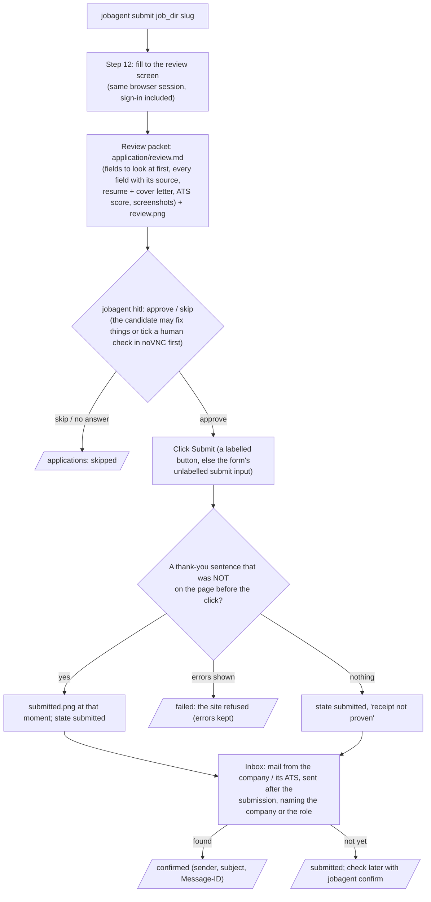

# Step 13 — Review, submit, confirmation email

The agent fills the application (step 12), shows it for review, and submits it only when the candidate answers
`approve`. Then it checks the page and the agent inbox for the confirmation.

**Status (2026-11-07): built and tested; gate open.** `skip` was tested twice on Mercor (nothing sent) and `approve`
once on Triumph Tech (Submit clicked; receipt not proven, see below). The gate — a submission whose confirmation
email is matched in the inbox — still needs one approved application on a real ATS.

## Run it

```bash
jobagent submit outputs/<company>/<job-id> <company-slug> [--ask-minutes 30] [--review-minutes 60] [--mail-minutes 15]
jobagent hitl answer <id> approve        # on the review prompt: submit it (or 'skip'); the exact id is required
jobagent confirm outputs/<company>/<job-id> [--minutes 5]   # look for a late confirmation mail
jobagent applications                    # every application's state
```

## How it works



## Rules

| Rule | Where |
|---|---|
| Submit is clicked only after the candidate's `approve` to that application's review prompt | `steps/submit.make_at_review` |
| `jobagent hitl answer` without an id never answers a submission prompt, nor picks among several pending requests | `main.hitl_answer` |
| A form whose only way forward is a human check ("I'm a human") or a hidden submit input counts as the review screen; the candidate does the check | `forms.human_check`, `forms.has_submit_input` |
| A thank-you only counts when it appears after the click; it is screenshotted then, the settled page again 5 s later | `submit.submitted_page` |
| The confirmation mail: sender domain of the company or its ATS family, sent after the submission, naming the company or the title | `submit.wait_for_confirmation` |
| Every state change is kept: filled, approved, submitted, confirmed, skipped, failed (with notes) | `applications` table |

## Results

| Application | Platform | Outcome |
|---|---|---|
| Mercor — AI Infrastructure Engineer | Ashby | review packet 12/12 fields; `skip` twice; nothing sent |
| Triumph Tech — QA & Dev Ops Engineer | company site | approved; Submit clicked after the candidate ticked "I'm a human"; the screenshot after the click shows the button still processing and no thank-you in view; no confirmation mail in 15 min: **receipt not proven** |

## Learned while building

- Ashby's yes/no questions are pairs of `aria-pressed` buttons over a hidden checkbox: they weren't fields at all, so
  the first Mercor review packet said "8/8" while 4 questions were unanswered. Button groups are now choice fields.
- Triumph Tech's form ends in an "I'm a human" check; its Submit is hidden (an unlabelled `input type=submit`) until
  the check is done.
- A thank-you phrase matched somewhere on the page right after the click, while the screenshot showed the request
  still running: confirmation now needs a sentence that wasn't there before the click.
- An id-less `hitl answer` from a test script answered a review prompt (with `skip`): submissions now need the id.
- Small company sites may send no confirmation mail; a real ATS (Workday, Greenhouse, Lever, Ashby) almost always does.
