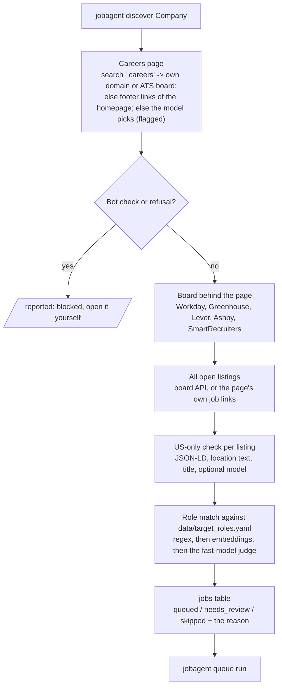

# Step 14 — Discovery and queue

From a company name (or a CSV of companies) to a queue of roles worth applying to. A job URL the candidate pastes is
**not** discovery: `jobagent scrape` always reads it, and a non-US location is only flagged later.

## Run it

```bash
docker exec jobagent jobagent discover "General Mills" "Intel, Mercor"       # or: discover data/targets.csv
docker exec jobagent jobagent discover Stripe --limit 50 --no-judge           # quick trial: 50 listings, no model judge
docker exec jobagent jobagent queue                                           # queued roles, best match first, with counts
docker exec jobagent jobagent queue --review                                  # the unsure ones (needs_review)
docker exec jobagent jobagent queue approve 12 15                             # needs_review / skipped -> queued
docker exec jobagent jobagent queue reject 13                                 # -> skipped for good
docker exec jobagent jobagent queue run --through scrape --limit 5            # take queued roles through the steps
```

`queue run --through` goes `scrape` (default) → `tailor` (adds research and the ~45 min resume loop) → `apply` (fills
the form to its review screen; never submits). Each job runs the existing commands in turn. A closed or blocked posting
is recorded and the next job starts. A run killed midway leaves its job `running`; the next run puts it back in the queue.

## How it works



| Part | File | Notes |
|---|---|---|
| Careers page | `tools/careers.py` | Search first (own domain / ATS board, `careers.` host or `/careers` path). Footer fallback: `<footer>` or the last 15% of the links, text or href says careers / jobs / join us. Last resort: the fast model picks among the results, flagged. Cached 30 days in `state/companies/<slug>.careers.json`; a miss is never cached. A Greenhouse board named like the company is accepted only when the board's own name matches the whole company name. |
| Listings | `tools/listings.py` | Greenhouse, Lever, Ashby and SmartRecruiters public posting APIs; Workday's `/wday/cxs/<tenant>/<site>/jobs` (the call its careers page makes), searched once per target role, 5 pages of 20; any other site: the job links on the page (best effort). A 401 / 403 / 429 or a bot check ends that company as `blocked`. |
| US-only | `tools/locations.py` | 1) schema.org `addressCountry`; 2) location text (state names and codes, "Remote - US", US cities against foreign countries, provinces and cities); 3) the title ("(US)", "- India", "EMEA"); 4) optional model. US keep; non-US skipped with the reason; "Remote" with no country, or a mix of the US and others: needs_review. `--all-countries` turns it off. |
| Role match | `tools/matching.py` | Global and per-role `exclude_patterns` reject; a `patterns` hit goes to the judge as a strong prior; no hit: embeddings (title + snippet against each role's description) at or above `semantic_threshold`; the fast-model judge answers {match, role_id, confidence, reason}: 0.7 and up is queued, 0.5-0.7 needs_review, below skipped. Per company: at most 400 titles embedded (one batched pass) and 80 judged. |
| Queue | `tools/jobqueue.py` | `jobs` rows: status, reason (`notes`), role, match stage and score, requisition id, posted date. Same job = same canonical URL (tracking parameters and fragments dropped, job-id parameters kept) or same company + requisition id; a skipped twin never hides another posting. A job past the queue is never overwritten by a later discovery. |
| Commands | `cli_discovery.py` | `discover`, `queue`, `queue approve|reject|run`. |

## Rules

| Rule | Where |
|---|---|
| A page that answers with a bot check or a refusal is reported to the candidate, never worked around | `careers.resolve`, `listings.Blocked`, `discovery.discover` |
| One company's failure (no careers page, blocked board, error) never stops the next | `discovery.discover_many` |
| The US-only filter applies to company / CSV discovery only; pasted URLs are exempt | `discovery.discover(only_us=)` |
| Every skipped listing keeps its reason (`location: ...` / `role: ...`) | `jobqueue.combine` |
| Closed postings found later are recorded by step 7 / 12 (`closed`, `blocked`) and the runner moves on | `queue run`, `tools/availability.py` |

## Results

Gate run 2026-11-09 (real sites, the user's `data/target_roles.yaml`: software engineer and ML engineer; entry-level seniority).

| Gate item | Result |
|---|---|
| Careers page for 10+ known companies | **12 of 12 found by search** (General Mills, KPMG, DOWL, Intel, Cafe Valley, Carvana, GoDaddy, Palantir, Stripe, DoorDash, Adobe, Mercor). DoorDash's page answers with a bot check: reported as blocked, not worked around |
| Footer fallback (3 or more where search fails) | With search switched off: **Stripe, Intel and General Mills found from the footer**. Adobe, Carvana, GoDaddy and Palantir were not (plain requests refused, or the footer is built by JavaScript) |
| US-only filter | 48 labelled locations all correct (`tests/unit/test_locations.py`). Live: **3,077 listings, 0 non-US queued**; General Mills' Powai / Mumbai roles skipped with `location: Powai is outside the United States` (41 of its 81 listings) |
| Role matching | 51 labelled titles, precision and recall 1.0 for the regex and threshold stages offline; live, the judge queued 88, sent 20 to review, skipped 2,969 |
| Roles queued | Palantir 57, Stripe 24 (+15 for review), Mercor 5, Intel 1 (+5), Carvana 1, General Mills 0 of 81, Cafe Valley 0 of 7 (food production) |
| Queued roles through the runner | `queue run --through scrape` took 2 Mercor roles to `scraped` (about 35 s each) |
| Queue resumes after a kill | A job left `running` (what a killed runner leaves) was put back and processed; unit-tested too |
| Tests | 372 unit tests pass (the 70 new ones are for step 14) |

Known gaps: KPMG's job search and DOWL's UltiPro board give 0 listings (no board API and no job links on the page: each
needs its own adapter); Workday sometimes lists only "2 Locations", which sends an otherwise good match to
`needs_review`; Palantir's 57 queued roles are many, so `queue run` takes the best-scored first.

## Learned while building

- Greenhouse boards can set every job's `requisition_id` to a placeholder (Stripe: "See Opening ID" on 772 jobs), so the
  unique job `id` is the requisition key. A duplicate check on the placeholder dropped 771 of 772 listings.
- An empty search answer is usually rate limiting; a miss cached as a result made Palantir "not found" for the next run.
  Misses are not cached and an empty search is retried once.
- A Greenhouse token alone isn't proof: "delta" is Delta Dental's board. The board's own name must match the company.
- Workday lists the same requisition once per office; a skipped (non-US) copy must not hide the US one.
- Sites with no board API and no job links on the page (KPMG's search app, DOWL's UltiPro board) give 0 listings: they
  need their own adapters (a later addition).
