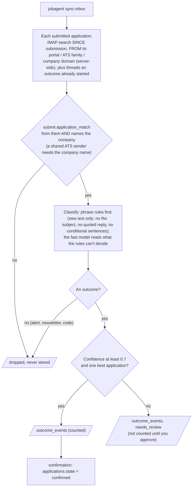

# Step 15 — Outcome learning

Reads what comes back for each submitted application (confirmations, assessments, interviews, offers, rejections), links
it to the application, labels outcomes without mistaking silence for failure, and reports what the history says. It
was built with **no real outcome history** (the candidate had submitted one application and received no reply), so
correctness is shown with labelled mail, date replays and simulated worlds; the limits of that are stated below.

## Run it

```bash
docker exec jobagent jobagent sync-inbox                 # read replies to submitted applications; add --dry-run to see first
docker exec jobagent jobagent sync-inbox --watch --every 6   # keep running, one sync every 6 hours (or: cron, below)
docker exec jobagent jobagent outcomes                   # each application's current and furthest stage
docker exec jobagent jobagent outcomes --review          # events waiting for your OK (low confidence, or two applications fit)
docker exec jobagent jobagent outcomes approve 3 4       # count them   |   outcomes reject 5   |   outcomes label <message-id> interview
docker exec jobagent jobagent stats [--csv out.csv]      # funnel, days to first response, rates by portal / role / score band / resume
docker exec jobagent jobagent reflect [--dry-run]        # what the history says (advisory)
```

A cron line on the host, once the container is up: `0 */6 * * * docker exec jobagent jobagent sync-inbox`. No image
change is needed.

## 15a — read, classify, link



**What it reads.** Only mail that matches a submitted application, sent after the submission. The mailbox is shared with
personal mail, so the sync filters on the server by sender and date (like `sweep_stale_verification`): unrelated mail is
never downloaded. It is read-only: nothing is trashed, labelled or marked read. Bodies are never stored: an event keeps
sender, subject, the mail's own Date and a 200-character excerpt.

**Stages:** confirmation, assessment, recruiter_screen, interview, offer, rejection, withdrawn.

| Part | File | Notes |
|---|---|---|
| Shared matcher | `steps/submit.py` `ApplicationMatch`, `application_match` | One definition of "this mail is for this application", used by the confirmation wait (step 13) and by the sync. From the company's own domain: names the company or a title word. From a shared ATS sender (Greenhouse, Lever, Workday...): must name the company (display name, subject or body); a title word like "engineer" alone would link another company's mail |
| Classifier | `tools/outcomes.py` | Rules look only at the new text (a "Re:" subject and a quoted reply are what the earlier mail said). A phrase inside a conditional sentence ("we will contact you to schedule an interview if...") is not a stage. "Thank you for applying" followed by progress words goes to the model. Confidence 0.9 for a rule, the model's own otherwise; below 0.7 the event waits for you. A model that says "confirmation" must have something about an application to point at |
| Sync and review | `tools/outcomes.py`, `cli_outcomes.py` | Ties between two applications of one company go to review. A later message in the same Gmail thread (a recruiter writing from a personal address) is linked through `X-GM-THRID`. De-duplicated by Message-ID |
| Tables | `db.py` | `outcome_events`, view `application_status` (current and furthest stage: a rejection after an interview shows both), `lessons`, snapshot columns on `applications` |

### Accuracy

| Check | Result |
|---|---|
| Labelled set, 57 messages (`tests/fixtures/outcome_emails/emails.yaml`: 15 none, 11 confirmation, 10 rejection, 7 interview, 5 assessment, 5 offer, 3 recruiter screen, 1 withdrawn; 4 of them are written so the rules cannot decide and the model must; 7 are regression cases from the held-out batches) | rules and model together: **100%**, **0 non-outcomes stored as outcomes**; rules alone decide the rest at 90% or better |
| Held-out batch 1: 90 messages written by another model (devstral2-123b), other companies, varied wording | **94.4% (85/90)** before any tuning to it, 0 non-outcomes stored as outcomes. Misses: 3 confirmations saying "we will contact you to schedule an interview if...", a curly apostrophe in "won't", "welcome to the team" in an offer |
| Held-out batch 2: 90 more, fresh companies, written after those fixes | **97.8% (88/90)**, 0 non-outcomes stored as outcomes. Misses: a rejection "decided to proceed with other candidates" (no "forward"), an interview invitation titled "Next Steps: Interview for ..." |
| After fixing both batches' misses | both 90/90, but that is tuned, not independent |
| Real mail the agent already holds from its own domains (7 messages: codes, ATS system mail) | all 7 classified as non-outcomes |
| `sync-inbox --dry-run` against the real mailbox | 1 submitted application (Triumph Tech, no reply yet), 0 messages downloaded |

**Limits, stated plainly.** The fixtures are written by the assistant, and the held-out batches by another model, so
real employers' wording will still surprise it; two batches of fresh mail each turned up two to five new phrasings. Add
real messages as they arrive (`outcomes label <message-id> <stage>`, then add the message to the fixtures) and re-run the
accuracy test. The priority is that a non-outcome is never stored as an outcome: that held in every batch.

## 15b — labels, timelines, stats

Pure functions of the stored events and an `as_of` date (`tools/outcome_stats.py`); everything is rebuilt each run, so a
late reply changes the labels by itself.

| Label | Rule |
|---|---|
| positive | an assessment, recruiter screen, interview or offer arrived; a later rejection does not erase it |
| negative | an explicit rejection with no positive stage before it |
| ghosted | nothing beyond the automated confirmation after the cutoff; a weak negative (weight 0.5); a late reply re-opens it |
| pending | inside the cutoff: a censored observation, never a failure |
| withdrawn | left out of every rate |

The ghosting cutoff is a statistical estimate only when it can be identified (F21): the day by which 90% of ALL applications
(responders and still-waiting ones, the latter censored) had responded - the Kaplan-Meier 90th percentile, clamped to 21-120
days - and only if at least 20 responded, the curve reaches 90% and at least 15 applications are still informative there.
Otherwise the conservative default of 45 days is used, `stats` prints the basis, and the result is labelled uncertain. A
percentile over the responders alone (a few fast replies among many silences) is never used as a deadline for everyone. Time
to first response uses Kaplan-Meier, so applications still waiting are not counted as failures; a median or "replied by 30
days" figure is shown only when at least 15 applications can tell. The "replied" and "positive" columns are SHARES OF THE
RESOLVED APPLICATIONS (with Wilson 95% intervals): fast replies and older applications are over-represented there, so they are
not callback probabilities; the KM columns are. Applications submitted after the evaluation date (`--as-of`) are not part of
that evaluation. What the submitted resume was (hash, checker scores, role family, skills) is frozen into `applications` at
submission and filled in for older rows at the first sync.

## 15c — learning, advisory

Asked of resolved applications only. **Advisory:** `reflect` prints findings with their evidence; three settings, all
off by default, each switch one lever into behaviour (`LEARNING_USE_SITE_MIX`, `LEARNING_USE_TAILORING_HINTS`,
`LEARNING_USE_LESSONS` in `.env`).

- **One test for the whole family (F23).** Every site and every skill-by-role-family comparison over the data floor is tested
  together by a Westfall-Young max-statistic permutation test (outcomes shuffled within role families, whole companies
  moving together), so the chance of ANY false recommendation in an effect-free world is held near 5% however many things are
  looked at. Checker sites: weighted AUC of the score for telling positive from not-positive applications; skills: weighted
  difference in the share of positive replies with and without the skill. Ghosted applications weigh 0.5 as negatives;
  pending ones are censored and left out. Skills are compared only when the snapshot's skill list is the submitted one.
- **Hold-out.** Findings come from the earliest 70% of resolved applications and must point the same way on the latest 30%
  to be actionable; contradicted ones are reported and not acted on.
- **Association, not cause.** Nothing here shows that raising a score or adding a skill brings replies.
- **Floors:** 15 positive and 15 not-positive resolved applications per group (among the earlier ones) before anything is said.
- **Lessons:** `lessons` rows with the application ids they rest on, versioned by a hash of the full evidence (scores, skills,
  weights, parameters): a lesson whose evidence changed is a new version even if its sentence did not; one the data stops
  supporting is retired. Only confirmed recommendations and "no relationship" notes are stored.
- **Switches:** the tailoring prompt gets the skills that went with replies and the active lessons for the job's role
  family (`tools/tailor.learning_hint`, empty without touching the database when both switches are off).
  `LEARNING_USE_SITE_MIX` is **unsupported and has no effect** (F24): the ATS loop always runs every required checker so that
  the five-site average stays comparable; `reflect` says so when it is set.
- **Repairing the record (F24):** `outcomes events` lists every event with its id; `outcomes discard <id>` removes an accepted
  false positive from the analysis (confirmation state and followers corrected, audited); `outcomes label <id> <stage>`
  relabels by event id; `sync-inbox --dry-run` changes nothing in the database.

### What the simulation says about how much data this needs

Simulated applications (about 30% positive after the planted effects; one site's score changes reply odds by 0.9 per
standard deviation; one skill multiplies the odds by 2.5, about 2.2 net; everything else is noise), 20 worlds per row:

| Resolved applications | Site that predicts is found | Skill with odds x2.5 is flagged | Recommendation when there is no effect |
|---|---|---|---|
| 100 | 75% | 15% | 10% |
| 150 | 100% | 35% | 15% |
| 300 | 100% | 65% | 5% |
| 500 | 100% | 95% | 10% |
| 800 | 100% | 100% | 15% |

Two honest readings. First, a skill effect of this size needs roughly 500-800 resolved applications; real reply rates are
lower than the simulation's, so the real figure is higher. At a few applications a week that is well over a year, which
is why nothing here is automatic. Second, even with no effect at all, about one world in ten produces a spurious
recommendation: another reason learning only advises.

## Results

| Gate item | Result |
|---|---|
| Seeded and real mail classified and linked | 57 labelled messages, two held-out batches of 90, 7 real agent-domain messages; linking, threads, ties, review, de-duplication in `tests/unit/test_outcomes.py` |
| Classifier accuracy at least 90% on 20+ emails | 100% on the 57 (tuned); 94.4% and 97.8% on fresh held-out batches; 0 non-outcomes stored as outcomes |
| Labels and the late reply after the cutoff | replays by `as_of`: ghosted at day 55, positive at day 61; rejection after an interview stays positive; Kaplan-Meier checked against a hand-computed example |
| Learning updates and lessons cite evidence | simulated worlds recover planted effects (at least 80% power at 800), report "not enough data" under the floors, retire lessons the data stops supporting; every lesson stores its application ids |
| Tests | 400+ unit tests pass on a clean copy of the committed code plus the step's files |

## Not done

- No real outcome has been seen: the first real replies will show what the fixtures missed.
- `sync-inbox` runs by hand, with `--watch` or from a host cron line; it does not yet run inside the container at bootstrap.
- Notifications for a new interview or offer are a printed line (and `outcomes`); a push or dashboard alert belongs to steps 17 and 19.
